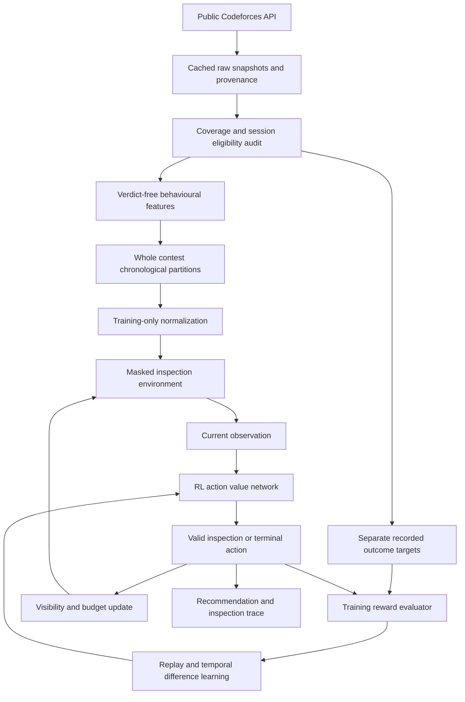
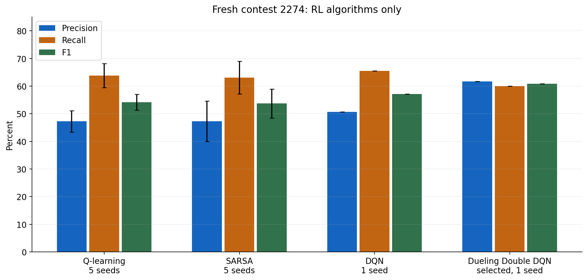
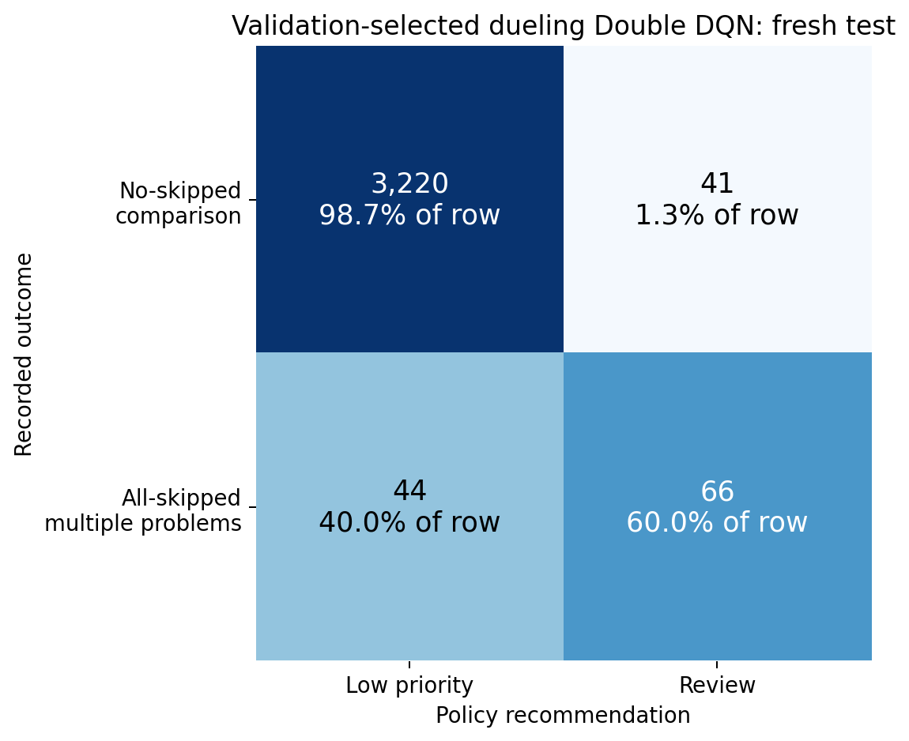
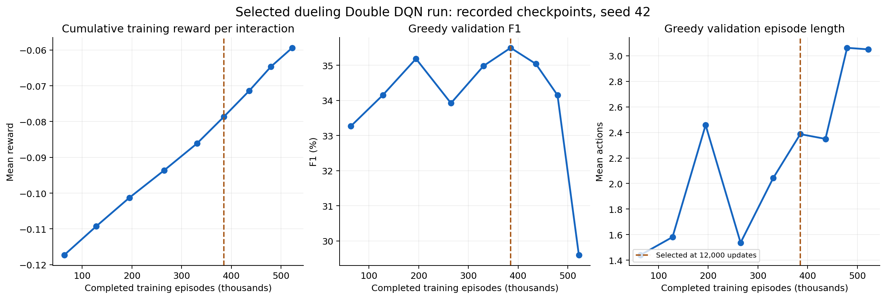

# Reinforcement Learning for Post Contest Codeforces Review

**Course:** 216U01E736 Reinforcement Learning, Semester VII

**Assessment:** LAB CA mini project, academic year 2026 to 2027

**Experiment date:** 13 October 2026

**Repository:** [ombhanushaliii/pilot](https://github.com/ombhanushaliii/pilot)

This project implements a reinforcement learning agent that reviews completed Codeforces participant-contest sessions. It decides which behavioural summaries to inspect and then recommends **REVIEW** or **LOW_PRIORITY**. The active comparison includes Q-learning, SARSA, DQN and dueling Double DQN. Validation selected dueling Double DQN; its original test result was **61.7% precision, 60.0% recall and 60.8% F1**.

The target is a recorded **all-skipped, multi-problem submission pattern**. It is an administrative-outcome proxy. Neither `SKIPPED` nor a model recommendation establishes cheating, AI use or fair participation. This distinction defines the scope of every result below.

This README follows the supplied report format. [Implementation details](docs/DEEP_RL.md), [enhancement experiments](docs/RECOMMENDATION_TESTS.md) and [documentation index](docs/README.md) provide supporting evidence. Superseded plans are retained under `docs/archive/`.

## 1. Title

**A Reinforcement Learning Agent for Behavioural Evidence Inspection in Post Contest Codeforces Review**

## 2. Problem Definition and RL Formulation

### 2.1 Problem statement

Completed coding contests contain many submission sequences, making systematic review difficult. Repeated submissions, rapid retries, concentrated attempts on a problem and language changes can describe unusual behaviour. These patterns also occur during legitimate problem solving, so a single heuristic cannot establish misconduct.

Given the complete submission metadata for a participant in a finished contest, the agent must choose a sequence of evidence-inspection actions and a final review recommendation. We train and evaluate against a precisely defined recorded outcome because independently verified AI-use labels are unavailable. The system reviews a particular session rather than permanently classifying an account.

### 2.2 Motivation and suitability of RL

The original motivation was AI-assisted contest misconduct. Public metadata cannot reliably distinguish AI assistance from copying, ordinary debugging or other causes of administrative action. We therefore narrowed the measurable task to predicting the recorded outcome from behaviour alone.

RL addresses the **sequential inspection decision**: inspect another group of evidence or stop with a recommendation. An inspection changes the available observation and incurs a declared cost; a terminal decision receives reward according to the outcome. The learner maximizes expected episode return through temporal-difference updates.

If all evidence is exposed immediately, the problem becomes a one-step decision task. RL is not automatically superior for that setting. The project studies a finite inspection policy using multiple RL algorithms, as required by the course, and does not claim that RL is necessary for ordinary binary classification. Inspection costs are simulated over cached data, not measured network or human-review costs.

### 2.3 Objectives

1. Collect complete, reproducible contest snapshots and build outcome-separated behavioural features.
2. Implement correct finite inspection environments and compare four RL algorithms.
3. Select settings using development data and evaluate the frozen policy on a later contest, including failures and subgroup results.
4. Test whether additional evidence and earlier behavioural context improve the policy without silently changing the benchmark.

### 2.4 RL problem formulation

| Component | Definition |
| --- | --- |
| Environment | An offline simulator backed by cached, completed participant-contest sessions. It reveals evidence on request and supplies rewards during training. It does not alter submissions or operate during a live contest. |
| Latent state | A fixed session's full behavioural record, its hidden recorded target, and the evidence visibility mask. |
| Agent observation | 24 normalized features, 24 missing-value flags, 3 visibility bits and a remaining-budget fraction: **52 values**. Only revealed groups and their missing flags are visible. |
| Action space | `inspect_pacing`, `inspect_trajectory`, `inspect_language`, `low_priority`, `review`. |
| Transition | Inspection reveals its group and updates the mask and budget. A terminal action ends the episode. The underlying session remains fixed. |
| Reward | Inspection: -0.005. Review a positive: +1. Miss a positive: -1. Review a comparison: -0.5. Low priority for a comparison: 0. |
| Policy | Epsilon-greedy exploration during training; greedy selection of the highest-valued valid action during inference. |
| Discount factor | Gamma = 1. The finite episode has at most four actions, so return is the sum of rewards without discounting. |
| Termination | `review` or `low_priority`. Each inspection is available once; after three inspections only terminal actions remain. |

The observation is partial: the agent does not receive the full latent state or the target. This is a finite partially observed evidence-inspection formulation. The network uses the current masked observation; it does not maintain a recurrent belief model. Labels remain hidden during inference and are used only for training rewards, replay stratification and evaluation.

The first five basic features are available initially. The remaining groups are revealed through actions:

| Group | Features |
| --- | --- |
| Basic, 5 | Attempts, attempted problems, first submission time fraction, last submission time fraction, attempts per hour. |
| Pacing, 7 | Minimum, 10th percentile, median and maximum submission gaps; fractions of gaps at most 15 and 60 seconds; maximum attempts in a 60-second window. |
| Trajectory, 8 | Retries, retry fraction, minimum and median retry gaps, fraction of retries within 60 seconds, largest problem attempt share, problem switch fraction and problem revisit fraction. |
| Language, 4 | Distinct languages, language switch fraction, within-problem language switch fraction and missing-language fraction. |

Time fractions use contest duration. Submission spacing does not measure typing time or when judge feedback became available. The API does not supply source code or code-edit distances, so the active model cannot observe large code rewrites. Handles, college, country, profiles, verdicts, judge results and administrative participation status are excluded from observations.

### 2.5 Selected algorithms and justification

| Algorithm | Role and reason for inclusion |
| --- | --- |
| Q-learning | A transparent tabular off-policy baseline. It updates toward the maximum valid next-action value. Discretization keeps its state table manageable. |
| SARSA | An on-policy tabular comparison. It updates toward the value of the actual next exploratory action, allowing us to compare this update with Q-learning. |
| DQN | Uses a neural value function to generalize across continuous behavioural observations. Replay and a target network support stable training. |
| Dueling Double DQN | The selected policy. Double DQN separates next-action selection from evaluation; the dueling architecture separates state value from action advantages. This configuration had the best validation F1 among the tested neural settings. |

Double DQN is intended to reduce action-value overestimation. Dueling value and advantage heads are useful when several actions have similar value. These are design reasons supported by the [Double DQN paper](https://arxiv.org/abs/1509.06461) and [dueling network paper](https://arxiv.org/abs/1511.06581), not proof of superiority on this dataset.

The action set is small and discrete, so value-based methods are a practical starting point. We did not train PPO or SAC and make no claims about their performance. The active pipeline contains no supervised classifier. Earlier classifier feasibility code and artifacts are retained solely for provenance, outside the active comparison.

## 3. Implementation and Working of the RL Agent

### 3.1 System architecture and workflow



At test time the saved policy receives features only. The target is opened for scoring after inference. Actions and targets are stored separately in reports.

**Collection and target construction.** Public API methods can be called anonymously. We use contest metadata and paginated `contest.status` responses, rather than requesting every user's history separately. The new collections use serial requests three seconds apart, bounded retries, response checksums and resumable checkpoints. Selected contest censuses continue to an empty page. Eligibility uses individual in-window participation and retains excluded records in audit trackers. See the [official API documentation](https://codeforces.com/apiHelp).

| Benchmark category | Rule |
| --- | --- |
| Positive | Every eligible in-window attempt is `SKIPPED`, across at least two attempted problems. |
| Comparison | At least two attempted problems and no observed skipped attempt. |
| Excluded from primary binary task | Single-problem, unresolved, replacement-compatible or other ambiguous skipped patterns. Retained for coverage reporting. |

Comparison does not mean verified fair. An all-skipped pattern does not reveal why submissions were skipped. Misconduct labels remain unknown.

We use complete archived contest populations, replacing the early 1,000-person development sample. College and country do not enter cohort selection or active model observations.

| Partition | Contests | Sessions | Positive | Comparison |
| --- | ---: | ---: | ---: | ---: |
| Training | 24 | 257,660 | 7,721 | 249,939 |
| Validation | 3 | 26,956 | 768 | 26,188 |
| Original test | 1 | 3,371 | 110 | 3,261 |

Training combines six 2025 contests and 18 earlier 2026 contests. Validation uses 2264, 2267 and 2269, which were evaluated previously and are explicitly development data. Test contest 2274 was selected before inspecting its outcome counts and first evaluated after freezing the original policy. It finished on 11 October 2026 and was collected on 13 October. An initial seven-day maturity search found no newer suitable contest; a separate frozen configuration declared a one-day minimum. Its recent outcomes may change.

Whole contests are chronologically separated. Returning handles are allowed, so the main test is not fully user-disjoint. We additionally report handles unseen in both training and validation. These are handles rather than verified identities.

### 3.2 Tools and technologies

| Purpose | Technology |
| --- | --- |
| Language and development | Python 3.13.2, Windows and PowerShell; package supports Python 3.11 or newer. |
| Collection and storage | Python standard library HTTP/JSON tools, SQLite, archived responses and SHA-256 checksums. |
| Numerical learning | NumPy 2.2.5 and PyTorch 2.6.0+cpu. |
| Visualization | Matplotlib 3.10.5; plots use actual saved measurements. |
| Verification | Python `unittest`, input/schema checks and artifact hash verification. |
| Resource control | One Torch/BLAS CPU thread for neural training. No browser is needed for the active dataset. |

### 3.3 Algorithm implementation

For Q-learning, the tabular update is:

```text
Q(s,a) <- Q(s,a) + alpha * [r + gamma * max_valid Q(s_next,a_next) - Q(s,a)]
```

SARSA substitutes the value of the next action actually selected by its exploratory policy for the maximum. Terminal updates use `r` only. Both mask invalid or repeated inspections.

For the selected neural policy, two shared 64-unit ReLU layers feed a scalar value head and five advantage outputs. The model has **7,942 parameters**. The dueling output is:

```text
Q(o,a) = V(o) + A(o,a) - mean_actions A(o,action)
```

The Double DQN target selects a valid next action with the online network and evaluates that action with the target network:

```text
next_action = argmax_valid Q_online(o_next, action)
target = r                                      if terminal
target = r + gamma * Q_target(o_next,next_action) otherwise
```

Plain DQN instead takes the maximum valid value from the target network. Training minimizes weighted SmoothL1 temporal-difference error. Hidden features and their missing flags are zeroed until inspected. Revealing a group changes the observation deterministically, and terminal transitions never bootstrap.

### 3.4 Hyperparameters and parameter settings

| Parameter | Active neural experiment |
| --- | --- |
| Optimizer and learning rate | AdamW, 0.001; weight decay 0.0001. |
| Discount factor | 1.0. |
| Exploration | Epsilon decreases linearly from 1.0 to 0.05 over 80% of updates. Greedy evaluation. |
| Training budget | 18,000 updates with 64 environment instances: 1,152,000 transitions per model. |
| Episodes | Variable because policies stop at different times. The selected configuration's seed-42 run completed 522,207 episodes. |
| Batch and replay | Batch 256; up to 50,000 transitions per target class; 500-update warmup. |
| Target update | Soft update, tau = 0.01. |
| Numerical controls | Gradient norm clipping at 5; normalized observations clipped to [-8, 8]. |
| Inspection budget and cost | Three optional groups, each inspected once; cost 0.005 per inspection. |
| Selected false-positive penalty | 0.5, searched against 0.1 and 0.25. |
| Validation checkpoints | Every 2,000 updates; best validation F1, then precision as tie-break. |
| Seeds | Search: 42. Selected configuration repeats: 736 and 2026. |

The tabular references use six training-quartile-binned summaries, explicit hidden and missing bins, alpha 0.05, gamma 1, and 500,000 episodes per seed. Their five seeds are 42, 736, 2026, 13 and 2718. Epsilon falls from 1 to 0.05 over 400,000 episodes; validation checkpoints occur every 50,000 episodes. Their original reward design was TP +20, FN -20, TN +1, FP -2 and inspection -0.05. They trained on the older 156,905-session population. These differences prevent treating the cross-family comparison as a controlled algorithm-only experiment.

### 3.5 Training procedure

1. Verify raw collection coverage, frozen schemas, unique session joins and whole-contest temporal separation. Build features and targets into separate tables.
2. Fit imputation and normalization statistics on training features only. Missing values have explicit indicators. Holdout records cannot influence these statistics.
3. Reset environments by uniformly sampling training sessions at their natural frequency. Explore only valid actions and record transitions.
4. Sample equal numbers of positive and comparison transitions from separate replay rings. Weight losses using the natural training-session class prior. This reduces omission of rare positives, but does not exactly correct every state-dependent replay distribution.
5. Update online values using Bellman targets and soft-update the target network. Evaluate greedy policies on validation at fixed intervals.
6. Select the checkpoint and configuration on validation. Freeze preprocessing, model hashes and selection before original test evaluation. Repeated seeds do not replace the selected seed based on test performance.

Five neural settings were searched: plain DQN with width 64 and penalty 0.25; dueling Double DQN with width 64 and penalties 0.10, 0.25 and 0.50; and width 128 with penalty 0.25. Repeating the winning setting produced seven models, **8,064,000 transitions** and **4,129,683 completed episodes**. Repeated transitions are not additional unique participants or submissions.

The selected checkpoint was update **12,000**, with validation F1 **35.50%**. Reward coefficients express a chosen tradeoff, while checkpoint selection uses F1. A high F1 policy need not maximize every alternative review-cost objective.

### 3.6 Working demonstration and expected output

The demo restores the selected weights and replays saved examples. It prints basic observations, actions, revealed groups, recommendation and inspection count. The recorded target and evaluation reward appear after the inference trace. Representative restored-model output is:

```text
Policy: dueling_double64_p050_42 | Example: fresh_116
Action 1 : review
Recommendation: REVIEW
Additional groups inspected: 0
Recorded outcome revealed after inference: 1
Evaluation reward including simulated costs: 1.0
```

A missed positive demonstrates a real limitation:

```text
Policy: dueling_double64_p050_42 | Example: fresh_35
Action 1 : inspect_pacing
Action 2 : inspect_language
Action 3 : inspect_trajectory
Action 4 : low_priority
Recommendation: LOW_PRIORITY
Additional groups inspected: 3
Recorded outcome revealed after inference: 1
Evaluation reward including simulated costs: -1.015
```

The output is a session recommendation with an action trace, not a cheating probability or automatic sanction. Q values are expected action returns, not calibrated confidence scores. The examples are anonymized, and the trace describes inspected evidence rather than a causal explanation of misconduct.

## 4. Results and Analysis

### 4.1 Experimental results

All four RL families were scored on the same original test contest:

| RL algorithm | Reporting basis | Precision | Recall | F1 |
| --- | --- | ---: | ---: | ---: |
| Q-learning | Five-seed mean | 47.3% | 63.8% | 54.2% |
| SARSA | Five-seed mean | 47.3% | 63.1% | 53.7% |
| Plain DQN | Seed 42, validation-selected checkpoint | 50.7% | 65.5% | 57.1% |
| Dueling Double DQN | Selected seed 42 and checkpoint | **61.7%** | 60.0% | **60.8%** |



The selected policy referred **107 of 3,371 sessions**: 66 positive outcomes and 41 comparison outcomes. It missed 44 positives and assigned low priority to 3,220 comparisons.

| Recorded outcome | Low priority | Review |
| --- | ---: | ---: |
| Comparison | 3,220 | 41 |
| Positive | 44 | 66 |



Across three seeds of the selected configuration, test F1 was **59.7% with sample standard deviation 1.4 percentage points**. Precision was 70.7% with standard deviation 9.5 points; recall was 52.7% with standard deviation 7.3 points. Q-learning F1 standard deviation was 2.8 points and SARSA 5.3 points. Seed variation is not a confidence interval over unseen contests.

### 4.2 Performance metrics

Precision measures how many review recommendations match the positive proxy. Recall measures how many proxy-positive sessions are referred. F1 balances those quantities. We also report confusion counts, referral rate, average inspections and episode return under the declared reward.

| Selected-policy metric | Original test |
| --- | ---: |
| Precision / recall / F1 | 61.68% / 60.00% / 60.83%. |
| Referral rate | 3.17%. |
| Comparison false-positive rate | 41 / 3,261 = 1.26%. |
| Mean additional inspections | 1.348 of three groups. |
| Mean episode length | 2.348 actions, including termination. |
| Total episode return across the test | -21.215 reward units, including 4,543 inspections. |
| Mean episode return | Approximately -0.00629 under the selected neural reward. |
| Always-low-priority reference | Zero recall; 96.7% accuracy; mean return approximately -0.03263. |

The selected return is derived from terminal rewards and actual inspection counts. We do not compare it directly with tabular return because tabular rewards differ. Raw accuracy is misleading in this imbalanced dataset: an agent making no referrals already achieves 96.7% accuracy.

For **708 handles unseen in training and validation**, with 80 positives, selected-policy precision was 70.1%, recall 67.5% and F1 68.8%. Their outcome frequency differs from the full test, so this does not estimate performance on every new account. CONTESTANT recall was **64/88 = 72.7%**. OUT_OF_COMPETITION recall was only **2/22 = 9.1%**; that small group had no comparison sessions and cannot establish specificity.

### 4.3 Graphs and visualization

The following figure uses the selected run's saved checkpoints. Its horizontal axis is completed training episodes. Reward is the cumulative mean **per interaction**, validation F1 measures outcome retrieval performance, and episode length is the mean number of greedy validation actions. These are recorded measurements, not synthetic training curves.



Cross-family comparison bars show different feature representations, training populations and reward designs. Tabular error bars represent seed standard deviations; the neural bars display fixed selected seeds. They do not show equal statistical uncertainty for all families.

### 4.4 Interpretation and discarded approaches

The policy learned to choose among inspections and terminal recommendations based on visible summaries. Some sessions were referred immediately; others required further evidence. This does not demonstrate that any particular timing or language pattern causes misconduct.

For the selected run, cumulative training reward per interaction improved from -0.1173 at 2,000 updates to -0.0594 at 18,000 updates as exploration decreased. Validation F1 peaked at **35.5% at 12,000 updates** and fell to **29.6% at 18,000**. Longer training was not automatically better, and the curves do not establish monotonic convergence. Best-checkpoint retention was therefore necessary.

The model's original test F1 was substantially higher than validation F1. We interpret this as contest variation and uncertainty, not proof that the model improved after training.

| Tested choice | Measured finding | Decision |
| --- | --- | --- |
| Plain DQN | Validation F1 32.47%, below selected dueling Double DQN's 35.50%. | Retained as an RL comparison; not selected. |
| Penalties 0.10 / 0.25 / 0.50, width 64 | Validation F1 27.09% / 34.42% / 35.50%. | Selected 0.50 for this experiment. |
| Width 128 instead of 64, penalty 0.25 | Validation F1 34.45% versus 34.42%, effectively tied. | Larger network was not justified as the default. |
| Equal-value ensemble of three existing selected-family seeds | Validation F1 35.35% versus 35.50%, with 1.89 versus 1.39 inspections. | Not adopted. No new ensemble fitting. |
| Free inspections | Two-fold seed-42 mean-contest F1 39.7% versus matched baseline 40.3%. | No demonstrated development gain. |
| All current evidence visible initially | Two-fold mean-contest F1 40.1% versus baseline 40.3%. | Not selected merely because its known-contest diagnostic was higher. |
| Earlier history with all evidence visible | Three-seed mean development-contest F1 41.4% versus 40.2%; known-contest diagnostic 62.0% versus 61.9%. | Small development gain, no convincing diagnostic improvement. Original policy retained. |

The enhancement study compared **18 valid RL trials** on two chronological folds covering six development contests. It added 13 earlier behavioural-context features from at most 20 strictly prior observed contests, without verdicts or profile attributes. These variants used matched 78-value observations and 9,606-parameter networks. All-visible variants are one-step contextual-bandit Q learners, with different episode lengths and information exposure.

The development-selected enhancement's fixed seed 42 scored **57.3% F1**, below its matched baseline's **62.6%**, on the previously used contest diagnostic. We did not choose a different seed or retrospectively adopt the all-visible variant's 67.0% diagnostic result. Contest 2274 was already used by then and cannot serve as an independent new test. The baseline in this matched study is separate from the original 52-value presentation model.

A first enhancement run exposed a derived timing feature before its inspection. We stopped it, preserved its source and weights, corrected the mask, added regression tests, and refitted affected trials. Seven unaffected controls were reused only after exact observation and prediction checks; eleven corrected-run trials were newly fitted. Invalid trials are excluded from the reported comparison. See [the enhancement report](docs/RECOMMENDATION_TESTS.md).

**Discarded collection routes.** Playwright encountered a looping Cloudflare challenge; exports from the ordinary logged-in browser worked for five pilot sources, but reliable unattended source collection was not established. An audited public source archive contained only 1,125 submissions in 2025, four skipped IDs from one contest, and insufficient recent coverage. We therefore completed the automated API-metadata route. Neither manual source downloads nor headless browser scraping is required for the active experiment.

### 4.5 Verification and limitations

The full automated suite contains **131 passing tests** from the latest completed model-development checks. It covers collection completeness, session joins, target rules, chronological separation, training-only preprocessing, hidden-feature invariance, action masks, hand-calculated Q-learning/SARSA/DQN targets, terminal transitions, replay weighting and actual reward-based learning on controlled fixtures. Saved-model inference and CSV confusion counts reproduce recorded results. Artifact hashes preserve the original weights and source snapshots.

A shuffled-training-target RL control achieved validation F1 **14.4%**, below 35.5%. It ran only 6,000 updates and used validation checkpoint selection. This is a limited diagnostic, not proof that leakage is impossible or a matched-budget model comparison.

The main limitations are:

- **Proxy labels:** outcomes do not identify confirmed misconduct, AI use or innocent comparison participants. Undetected misconduct may remain in the comparison group.
- **Snapshot stability:** recent administrative outcomes can change. The frozen result describes the collected snapshot.
- **Selection and coverage:** standard Div. 2 contests and multi-problem eligible sessions exclude other contest formats and ambiguous cases.
- **Generalization:** one original test contest with 110 positives provides limited evidence. Returning handles overlap partitions, and subgroup recall can be poor.
- **Comparison fairness:** tabular and neural learners differ in inputs, population, rewards and selection. The DQN/dueling Double DQN pair also changes two components together.
- **Simulated costs:** inspections reveal already cached summaries. We have not measured moderator time or real API savings.
- **Metadata limits:** no source-code differences, reliable code-generation labels, problem reading time or judge-feedback timing are available to the agent.

### 4.6 Future scope

Freeze the present model for the course demonstration. Future work should evaluate a predeclared configuration on additional untouched, sufficiently settled contests, strengthen session-specific label evidence, and compare algorithms under identical inputs, rewards and training populations. Historical context requires further independent evaluation before adoption. Calibrated review confidence and realistic review costs would require separate validation. Source features remain optional if reliable coverage becomes available.

### 4.7 Conclusion

The project implements and evaluates four RL approaches for a finite post-contest inspection problem. Validation selected a compact dueling Double DQN with 60.8% F1 on its original later-contest test. It can produce reproducible review recommendations and inspection traces, but has meaningful failures and does not establish cheating or AI-use accuracy. Enhancement experiments produced a small development gain without a convincing new generalization result, so the original policy remains the presentation model.

## 5. References

1. Sutton, R. S. and Barto, A. G. *Reinforcement Learning: An Introduction*, second edition, MIT Press, 2018. Foundations for returns, Q-learning and SARSA.
2. van Hasselt, H., Guez, A. and Silver, D. [Deep Reinforcement Learning with Double Q-learning](https://arxiv.org/abs/1509.06461), AAAI 2016.
3. Wang, Z. et al. [Dueling Network Architectures for Deep Reinforcement Learning](https://arxiv.org/abs/1511.06581), ICML 2016.
4. Codeforces. [API documentation](https://codeforces.com/apiHelp), [methods](https://codeforces.com/apiHelp/methods) and [return objects](https://codeforces.com/apiHelp/objects). Data access and schema.
5. PyTorch. [Reinforcement Learning DQN tutorial](https://docs.pytorch.org/tutorials/intermediate/reinforcement_q_learning.html). Implementation background; the project uses its own finite simulator.
6. Project evidence: `deep-benchmark-2026-001`, `deep-rl-2026-001` and `recommendation-tests-002`, with frozen configurations, checksums, recorded results and learning curves.

## Appendix A. Run and demonstrate

Run these commands from the repository root in the intended Python environment:

```powershell
python -m pip install -r requirements-rl.txt
python -m unittest discover -s tests -v
python tools/demo_deep_rl.py --case true_positive
python tools/demo_deep_rl.py --case false_positive
python tools/demo_deep_rl.py --case false_negative
```

**A fresh clone does not include data or model weights.** The demo needs the verified local `data/deep-benchmark-2026-001`, `data/deep-rl-2026-001` and `reports/deep-rl-2026-001` artifacts. Collection snapshots, browser profiles, credentials, source exports and account-level prediction files are excluded from Git. Figures and an aggregate result summary are included under `docs/assets/`.

For documented reproduction from existing raw archives:

```powershell
python tools/prepare_deep_benchmark.py
python tools/train_deep_rl.py
python tools/legacy_rl_comparison.py evaluate
python tools/plot_deep_rl.py
```

Preparation requires the source archives referenced in the frozen manifest. The legacy comparison requires its saved tabular policies. Completed training cache reuse verifies existing artifacts instead of fitting again. A missing completed cache can start training, so these are reproduction commands rather than requirements for a saved-model demo. No training or new submission collection was performed for this report cleanup.

## Appendix B. Repository organization and viva notes

```text
cf_pilot/       collection, benchmark, RL environments and learners
config/         frozen collection and experiment configurations
tests/          automated integrity and RL correctness checks
tools/          preparation, experiments, verification and demos
docs/           technical reports, aggregate figures and archived plans
README.md       formal project report and demonstration instructions
STATUS.md       current checkpoint and remaining work
PROJECT_PLAN.md current scope and rules
```

Historical code remains in place where saved hashes, tests or tabular reproduction depend on it. Only `requirements-rl.txt` is needed for active RL training; source-browser and historical training requirements are optional. The supervised historical runner is not an active demonstration command.

For viva, be ready to explain why the task is sequential, why observations are partial, how the hidden target supplies reward without becoming an input, why terminal transitions do not bootstrap, how SARSA differs from Q-learning, how Double DQN differs from DQN, why the best checkpoint precedes the final update, and why a high raw accuracy does not establish useful retrieval of rare outcomes. Student names, roll numbers, division/batch and submission date must be entered in the institution's final cover sheet; they are not inferred from repository metadata.
